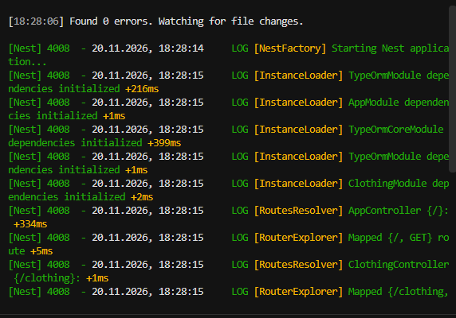
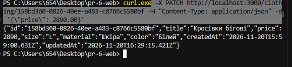

# Звіт про виконання практичної роботи № 7

**Тема:** Інтеграція реляційної бази даних PostgreSQL та ORM TypeORM у веб-застосунок на базі фреймворку NestJS.

**Мета роботи:** Набути практичних навичок підключення та налаштування реляційної СКБД PostgreSQL у проєкті NestJS, проєктування сутностей (Entity) за допомогою декораторів TypeORM, реалізації асинхронних CRUD-операцій з використанням патерну Repository та забезпечення фізичного збереження даних між перезапусками сервера.

---

## 1. Хід виконання роботи

### 1.1. Розгортання та конфігурація бази даних PostgreSQL
Для зберігання даних веб-застосунку використано реляційну систему керування базами даних **PostgreSQL 14**, розгорнуту локально (порт `5433`), та графічний клієнт адміністрування **pgAdmin 4**.
* Створено окрему базу даних **`store_db`**.
* Налаштовано роль суперкористувача `postgres` з паролем для автентифікації застосунку.

*(Місце для скріншота: вікно pgAdmin 4 із розгорнутою базою даних `store_db` та створеною таблицею `clothing` у схемі `public`)*

### 1.2. Підключення TypeORM у кореневому модулі (`AppModule`)
До проєкту встановлено необхідні залежності (`@nestjs/typeorm`, `typeorm`, `pg`). У файлі `src/app.module.ts` виконано конфігурацію модуля `TypeOrmModule.forRoot()` з увімкненими опціями автоматичного завантаження сутностей (`autoLoadEntities: true`) та синхронізації схеми бази даних (`synchronize: true`):

```typescript
import { Module, NestModule, MiddlewareConsumer } from '@nestjs/common';
import { TypeOrmModule } from '@nestjs/typeorm';
import { AppController } from './app.controller';
import { AppService } from './app.service';
import { ClothingModule } from './clothing/clothing.module';
import { HttpLoggingMiddleware } from './common/middleware/http-logger.middleware';

@Module({
  imports: [
    TypeOrmModule.forRoot({
      type: 'postgres',
      host: 'localhost',
      port: 5433,
      username: 'postgres',
      password: '12345678',
      database: 'store_db',
      autoLoadEntities: true,
      synchronize: true,
    }),
    ClothingModule,
  ],
  controllers: [AppController],
  providers: [AppService],
})
export class AppModule implements NestModule {
  configure(consumer: MiddlewareConsumer) {
    consumer.apply(HttpLoggingMiddleware).forRoutes('*');
  }
}
```

### 1.3. Проєктування сутності (`ClothingEntity`)
Замість зберігання даних у оперативній пам'яті (`in-memory`) створено модель таблиці `clothing` у файлі `src/clothing/entities/clothing.entity.ts` з використанням декораторів TypeORM:
* `@PrimaryGeneratedColumn('uuid')` — первинний ключ формату UUID;
* `@Column(...)` — поля опису товару (`title`, `price` типу `decimal`, `size` типу `enum`, `material`, `color`);
* `@CreateDateColumn()` та `@UpdateDateColumn()` — автоматичні мітки часу створення та останнього оновлення запису.

### 1.4. Реалізація сервісу та контролера (CRUD-операції)
У `ClothingModule` зареєстровано сутність через `TypeOrmModule.forFeature([ClothingEntity])`. У `ClothingService` інжектовано репозиторій `@InjectRepository(ClothingEntity) private readonly clothingRepository: Repository<ClothingEntity>` та реалізовано повний набір асинхронних методів роботи з БД:
* `create()` — створення та збереження нового запису (`create` + `save`);
* `findAll()` — отримання переліку всіх записів (`find`);
* `findOne()` — пошук запису за ідентифікатором UUID (`findOneBy`) з викиданням винятку `NotFoundException` у разі відсутності;
* `update()` — часткове оновлення полів запису (`preload` + `save`);
* `remove()` — видалення запису з бази даних (`remove`).

---

## 2. Тестування та перевірка збереження стану

Після запуску сервера (`npm run start:dev`) відбулася автоматична міграція схеми та створення таблиці `clothing` у базі даних `store_db`. Працездатність усіх ендпоінтів перевірено за допомогою HTTP-запитів (`curl`):

| HTTP-метод | Ендпоінт | Призначення | Результат виконання |
| :--- | :--- | :--- | :--- |
| **POST** | `/clothing` | Створення нового товару («Кросівки бігові») | Код `201 Created`, згенеровано UUID `158bd360-0826-40ee-a483-c8766c5580bf` та мітки часу |
| **GET** | `/clothing` | Отримання списку всіх товарів | Код `200 OK`, повернено масив із збереженим записом із PostgreSQL |
| **PATCH** | `/clothing/:id` | Оновлення вартості товару (`2890.00`) | Код `200 OK`, ціну оновлено, автоматично змінено поле `updatedAt` |
| **DELETE** | `/clothing/:id` | Видалення товару за UUID | Код `200 OK`, запис видалено з таблиці |

**Перевірка персистентності (збереження даних між перезапусками):**
Після повної зупинки процесу Node.js (`Ctrl + C`) та повторного запуску сервера (`npm run start:dev`) виконано повторний запит `GET /clothing` та перевірено вміст таблиці через інструмент *View/Edit Data $\rightarrow$ All Rows* у pgAdmin 4. Раніше створені та оновлені дані залишилися незмінними у базі даних PostgreSQL.

*(Місце для скріншотів: 1) термінал VS Code із логами успішного старту NestJS та виконанням POST/GET/PATCH запитів; 2) таблиця `clothing` із рядком даних у pgAdmin 4)*


---




## 3. Висновки

У ході виконання практичної роботи № 7 було успішно здійснено перехід від тимчасового зберігання даних в оперативній пам'яті до повноцінної реляційної бази даних PostgreSQL. Налаштовано інтеграцію ORM TypeORM у застосунку NestJS, описано структуру таблиці `clothing` за допомогою декораторів сутностей та переведено бізнес-логіку сервісу на асинхронну взаємодію через патерн Repository. Тестування підтвердило коректну роботу всіх CRUD-операцій та надійне фізичне збереження стану застосунку незалежно від перезапусків сервера.

[def]: pr-6-web/